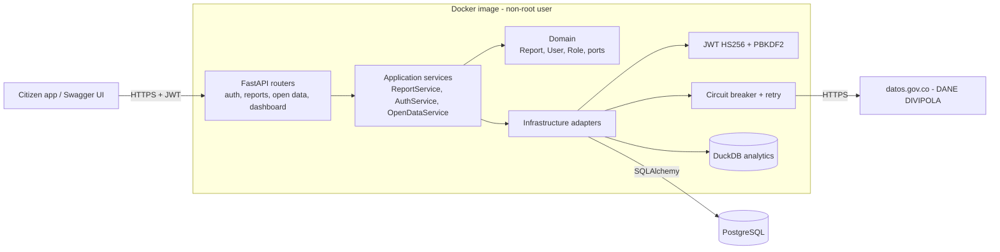
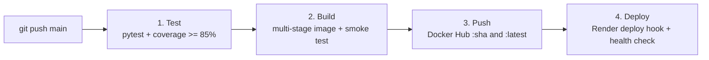

# CityMove API

[](https://github.com/juanicolasperez1104-ui/citymove-api/actions/workflows/ci-cd.yml)


CityMove is a REST API where citizens report urban-infrastructure problems such as potholes, broken streetlights, damaged sidewalks or blocked sewers. Each report has a category, a location, an optional priority and a status that moves through a controlled life cycle (open, in progress, resolved). Municipalities are validated against the official DANE DIVIPOLA open dataset of Colombia, so a report always points to a real municipality code. The project supports the United Nations Sustainable Development Goal 11 (sustainable cities and communities) by giving citizens a simple channel to take part in the care of their city.

This repository is the semester project of the **Programming Workshop** course (Software Engineering, Universidad Manuela Beltrán, 2026-2). It grew guide by guide: a CRUD API with uniform error handling, an AI triage prototype, a hexagonal architecture with open-data adapters and resilience patterns, quality and security hardening, and finally a cloud-native deployment.

**Live API:** https://citymove-api.onrender.com (Swagger UI at [/docs](https://citymove-api.onrender.com/docs)) · **Docker image:** [nicolasperez11/citymove-api](https://hub.docker.com/r/nicolasperez11/citymove-api)

## Architecture

The code follows a hexagonal (ports and adapters) architecture. The domain has no framework imports, the application layer talks only to ports, and the infrastructure layer provides the concrete adapters. An automated test (`tests/domain/test_architecture.py`) fails the build if an inner layer imports an outer one.





## Features

- **Reports CRUD** with validation, pagination, filters and a status state machine (invalid transitions return 409).
- **JWT authentication and role-based access control.** Citizens (`USER`) create reports; only `ADMIN` can update or delete them and list users. Tokens are signed with HS256, the algorithm is pinned, and the role is read from the database on every request, so a forged role claim cannot escalate privileges.
- **Open data integration** with DANE DIVIPOLA and the datos.gov.co catalog, protected by a circuit breaker and retries with exponential backoff. If the source is down, reports are still saved with `municipality_verified=false`.
- **Analytics dashboard** built with DuckDB.
- **Uniform JSON errors** (`status`, `error`, `detail`, `path`) for every failure, plus security headers on every response.

## Run it locally with Docker

```bash
cd citymove-api
cp .env.example .env          # then edit every value
docker compose up -d --build  # API + PostgreSQL, both with health checks
docker compose ps             # wait until both services are "healthy"
open http://localhost:8000/docs
```

The image uses a two-stage build. The first stage installs dependencies into a virtual environment; the second stage copies only that environment and the `app/` package onto `python:3.12-slim` and runs as the unprivileged user `app` (UID 10001). Compared with a naive single-stage image based on `python:3.12`, the size dropped from 1.86 GB to 356 MB on disk (494 MB to 85.8 MB compressed), and the container no longer runs as root.

## Run it without Docker

```bash
pip install -r requirements-dev.txt
pytest -q --cov=app                         # 71 tests, about 95% coverage, no network needed
uvicorn app.main:create_app --factory --reload
```

## Configuration

| Variable | Purpose |
|---|---|
| `DATABASE_URL` | SQLAlchemy URL. PostgreSQL in Docker and Render, SQLite by default |
| `JWT_SECRET` | Signing key, at least 32 characters. Required in production |
| `ADMIN_USERNAME`, `ADMIN_PASSWORD` | Seed the first administrator account. No credentials are hard-coded |
| `DATOS_GOV_APP_TOKEN` | Optional Socrata token for higher open-data rate limits |
| `PORT` | Port used by uvicorn (Render sets it automatically) |

## Continuous integration and delivery

The workflow `.github/workflows/ci-cd.yml` has four stages. **Test** installs the dependencies and runs pytest with a coverage gate of 85%. **Build** creates the linux/amd64 image with Buildx and layer caching, starts it, checks that it does not run as root and that `/health` answers. **Push** tags the image with the commit SHA and `latest` and pushes both to Docker Hub. **Deploy** calls the Render deploy hook with the exact SHA image and waits until the public `/health` endpoint answers. Pull requests run only the first two stages.

Repository secrets: `DOCKERHUB_USERNAME`, `DOCKERHUB_TOKEN`, `RENDER_DEPLOY_HOOK_URL`. Repository variable: `RENDER_APP_URL`. The `render.yaml` blueprint creates the web service and a managed PostgreSQL database.

## Quick API tour

```bash
curl -X POST $URL/api/v1/auth/register -H 'Content-Type: application/json' \
     -d '{"username":"maria","password":"Maria-12345"}'
TOKEN=$(curl -s -X POST $URL/api/v1/auth/login -d 'username=maria&password=Maria-12345' | jq -r .access_token)
curl -X POST $URL/api/v1/reports -H "Authorization: Bearer $TOKEN" -H 'Content-Type: application/json' \
     -d '{"title":"Pothole on Av. Boyaca","description":"A cyclist fell into it","category":"pothole","address":"Av. Boyaca con calle 80","latitude":4.69,"longitude":-74.09}'
```

## Project structure

```
app/domain          entities, value objects and ports (pure Python)
app/application     use cases with constructor injection
app/infrastructure  persistence, security, open data, resilience, analytics
app/api             FastAPI routers, schemas, error mapping, composition root
tests/              domain, application, infrastructure and API tests
docs/               ADRs and evidence for each lab guide
```

## Responsible use of AI

GitHub Copilot was used as an assistant. Every suggestion was read, tested and, when needed, corrected before it was committed. The lab report documents which suggestions were wrong and how they were fixed.

## Author

Juan Nicolás Pérez Alfaro, Software Engineering student, Universidad Manuela Beltrán (Bogotá, Colombia).
